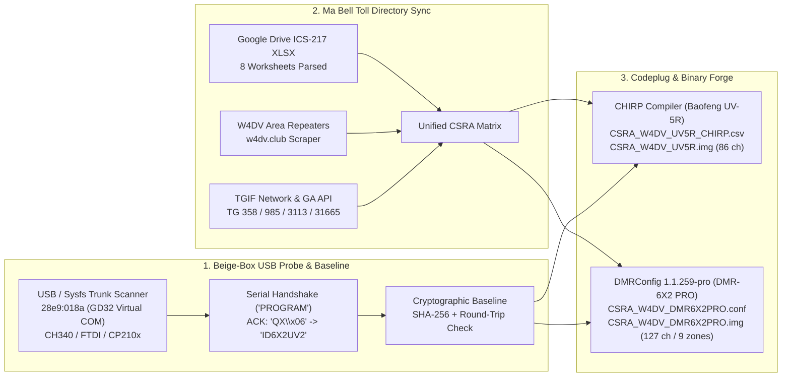

# `csra-ham-dmr-automation` // The CSRA Phreak, CW & Packet Underground

```text
 ._________________________________________________________________________.
 |  ____ ____ ____    _      ____  _   _ ____  _____    _    _  __         |
 | / ___/ ___|  _ \  / \    |  _ \| | | |  _ \| ____|  / \  | |/ /         |
 || |   \___ \ |_) |/ _ \   | |_) | |_| | |_) |  _|   / _ \ | ' /   [2600] |
 || |___ ___) |  _ < ___ \  |  __/|  _  |  _ <| |___ / ___ \| . \   [ Hz ] |
 | \____|____/|_| \_\_/ \_\ |_|   |_| |_|_| \_\_____/_/   \_\_|\_\         |
 |-------------------------------------------------------------------------|
 |  * HACK THE PLANET (AND THE REPEATER INPUT OFFSET) *                    |
 |  * THE KNIGHTS WHO SAY "--... ...--" (73) // DE KR4JLC [ID: 3221824] *  |
 |  * CW: -.-. --.-  -.. .  -.- .-. ....- .--- .-.. -.-.  -...-  -.-      |
 |  * "What... is the airspeed velocity of an unladen RF carrier?"         |
 |    "What do you mean? An African or an ITU Region 2 carrier?"           |
 `-------------------------------------------------------------------------'
```

<p align="center">
  
</p>

> **Callsign:** `KR4JLC` (`-.- .-. ....- .--- .-.. -.-.`) | **Handle:** `D4RKSP2RK` | **DMR ID:** `3221824`
> **Target Hardware:** **BTECH DMR-6X2 PRO** (`D6X2UV2` / USB `28e9:018a`) & **Baofeng UV-5R** (`HN5RV011`)
> **Theater of Operations:** Augusta, GA / Evans / Grovetown / North Augusta & Aiken, SC (**CSRA**)
> **Windows Suite & Manual CHIRP Guide:** See **[`windows/README.md`](file:///home/d4rksp2rk/Desktop/jarvis/csra-ham-dmr-automation/windows/README.md)** ([`Invoke-CsraChirp.ps1`](file:///home/d4rksp2rk/Desktop/jarvis/csra-ham-dmr-automation/windows/Invoke-CsraChirp.ps1) & [`Run-CsraChirp.bat`](file:///home/d4rksp2rk/Desktop/jarvis/csra-ham-dmr-automation/windows/Run-CsraChirp.bat))
> **Official CHIRP Wiki Reference:** **[https://chirpmyradio.com/projects/chirp/wiki/Home](https://chirpmyradio.com/projects/chirp/wiki/Home)**
> **Zine Companion:** Read [`PHRACK_CSRA_2600.nfo`](file:///home/d4rksp2rk/Desktop/jarvis/csra-ham-dmr-automation/PHRACK_CSRA_2600.nfo) for the full 1995 ASCII e-zine lore!

---

## `0x00` // What Is Thy Quest? (`--.- ..- . ... -`)

Back in 1995, seizing a trunk line took a plastic Cap'n Crunch Bo'sun whistle resonating at **2600 Hz**, a soldering iron, a handful of crystals for a **Blue Box**, and a healthy fear of Ma Bell's security division. Today, licensed HAMs are the legal heirs to the phreaking underground—except instead of whistling `2600 Hz` into a payphone handset, we:
1. **Blue-Box the USB Bus:** Auto-detect connected **BTECH DMR-6X2 PRO** (`28e9:018a` GD32 CDC ACM) and **Baofeng UV-5R** (K-plug CH340/FTDI/CP210x) radios via non-destructive serial handshakes (`"PROGRAM"` $\rightarrow$ `"QX\x06"` $\rightarrow$ `"\x02"` $\rightarrow$ `"ID6X2UV2"`).
2. **Lock the Holy Hand Grenade Baseline:** Extract current firmware/EEPROM images (`1,606,528` bytes for DMR-6X2 PRO; `6,645` bytes for UV-5R), verify round-trip compilation integrity, and seal them with **SHA-256 cryptographic manifests**.
3. **Raid the Castle of Aaaaargh (Live CSRA Scraping):** Pull the latest repeater & talkgroup matrices from:
   * **Amateur Radio Club of Augusta (`W4DV`):** [`w4dv.club/repeaters/area-repeaters/`](https://w4dv.club/repeaters/area-repeaters/) & the official CSRA **ICS-217** 8-sheet frequency workbook.
   * **CSRA DMR Group & TGIF Network:** [`tgif.network`](https://tgif.network) & the Georgia/CSRA Talkgroup API (`TG 358` CSRA Talk, `TG 985` K4KNS, `TG 3113` GA State, `TG 31130` GA ARES, `TG 31665` TGIF All Call, `TG 43389` SE Link).
4. **Synthesize Ready-to-Flash Codeplugs:** Compile binary `.img` codeplugs for both **CHIRP** (`CSRA_W4DV_UV5R.img`) and our custom-patched **`dmrconfig 1.1.259-pro`** (`CSRA_W4DV_DMR6X2PRO.img`).

---

## `0x01` // Architecture of the Phreak Pipeline (`-... .-.. ..- . -... --- -..-`)



---

## `0x02` // The Book of Armaments: Why Stock `dmrconfig` Threw a Flesh Wound on `D6X2UV2`

> *"First shalt thou take out the Holy Pin. Then shalt thou count to Color Code One, no more, no less. Color Code One shall be the number thou shalt count, and the number of the counting shall be One (unless thou art on K4KNS Belair Water Tank `444.900 MHz`, whereupon thou shalt proceed directly to Color Code Fifteen)."*

When we inspected the raw binary dump of the **BTECH DMR-6X2 PRO** (`D6X2UV2`, firmware `24040800D0060110`), we uncovered a critical bug in upstream `dmrconfig`:
1. In [`vendor/dmrconfig/radio.c`](file:///home/d4rksp2rk/Desktop/jarvis/csra-ham-dmr-automation/vendor/dmrconfig/radio.c), the USB/image signature `"D6X2UV2"` was previously aliased to `&radio_d878uv2` (AnyTone AT-D878UVII), whereas `radio_read_image()` matched the 6-byte prefix `"D6X2UV"` to `&radio_dmr6x2`.
2. In [`vendor/dmrconfig/anytone_ht.c`](file:///home/d4rksp2rk/Desktop/jarvis/csra-ham-dmr-automation/vendor/dmrconfig/anytone_ht.c), the BTECH DMR-6X2 family stores **8 scanlist indices per channel** starting at `ch->aprs_channel`, whereas the AnyTone D878UV stores a single scanlist index at `ch->scan_list_index` (`offset +0x22`).
3. Because `get_scanlist_index()` and `setup_channel()` only checked `if (radio == &radio_dmr6x2)`, live operations against a `D6X2UV2` misread channel bytes as `Scanlist 1` and aborted compilation with **165 `scanlist 1 not found` errors** (*"It's just a flesh wound!"*).

**Our Patch (`dmrconfig 1.1.259-pro`):** We defined [`radio_dmr6x2pro`](file:///home/d4rksp2rk/Desktop/jarvis/csra-ham-dmr-automation/vendor/dmrconfig/radio.h#L47) (`"BTECH DMR-6X2 PRO"`), mapped `"D6X2UV2"` to `&radio_dmr6x2pro` in [`radio.c`](file:///home/d4rksp2rk/Desktop/jarvis/csra-ham-dmr-automation/vendor/dmrconfig/radio.c), and updated [`anytone_ht.c`](file:///home/d4rksp2rk/Desktop/jarvis/csra-ham-dmr-automation/vendor/dmrconfig/anytone_ht.c) so both `radio_dmr6x2` and `radio_dmr6x2pro` use the 8-scanlist byte layout.

---

## `0x03` // Stabilized Hardware & Firmware Vault (`--... ...--`)

| Radio | Hardware Magic / USB | Firmware / Build | Size (Bytes) | SHA-256 Digest | Vault Path |
| :--- | :--- | :--- | :--- | :--- | :--- |
| **BTECH DMR-6X2 PRO** | `D6X2UV2` (`28e9:018a`) | `24040800D0060110` (`2024-4-12`) | `1,606,528` | `8e54ba6be555...5e91` | [`data/stable_firmware/dmr6x2_pro/`](file:///home/d4rksp2rk/Desktop/jarvis/csra-ham-dmr-automation/data/stable_firmware/dmr6x2_pro/) |
| **Baofeng UV-5R** | `BFS311` / CHIRP `UV-5R` | `HN5RV011` (`180618N`) | `6,645` | `2788557f103d...118f` | [`data/stable_firmware/uv5r/`](file:///home/d4rksp2rk/Desktop/jarvis/csra-ham-dmr-automation/data/stable_firmware/uv5r/) |

---

## `0x04` // The CSRA Trunk Matrix (W4DV, K4KNS, TGIF & BrandMeister)

### A. Digital DMR Repeaters & Hotspots (`Zones 1–3`)
| Repeater / Call | Location | Output (MHz) | Offset | CC | Network | Primary Talkgroups (`TS1` / `TS2`) |
| :--- | :--- | :--- | :--- | :--- | :--- | :--- |
| **W4DV DMR** | Augusta / Trenton | `442.5500` | `+5.0` | `CC 1` | **TGIF** | `TG 358` (CSRA Talk), `TG 31665` (TGIF All), `TG 3113` (GA State), `TG 31130` (GA ARES), `TG 43389` (SE Link), `TG 985` (K4KNS) |
| **KK4CNM** | Grovetown, GA | `147.1950` | `+0.6` | `CC 1` | **TGIF** | `TG 358` (CSRA Talk), `TG 3113` (GA State) |
| **K4KNS Belair** | Evans (Belair Water Tank) | `444.9000` | `+5.0` | `CC 15` | **TGIF** | `TS1`: `TG 358` (CSRA Talk) / `TS2`: `TG 985` (K4KNS Local) |
| **K4KNS Wrens** | Wrens GPB Tower, GA | `444.1750` | `+5.0` | `CC 1` | **Vidalia SG** | `TG 9` (Local SG), `TG 3113` (GA State), `TG 31130` (GA ARES), `TG 31137` (Kingsland), `TG 314722` (CSRA Multi-Mode), `TG 2` (PRN) |
| **N2ZZ Aiken** | Aiken, SC | `443.4625` | `+5.0` | `CC 1` | **BrandMeister** | `TG 3145` (SC State), `TG 3113` (GA State), `TG 314722` (CSRA MM), `TG 9` (Local), `TG 9990` (Parrot) |
| **WR4SC SCHEART** | Beech Island / Barnwell / Aiken / Greenwood | `444.2875` / `440.6875` / `440.8000` | `+5.0` | `CC 1` | **SCHEART / PRN** | `TG 27500` (PRN Local), `TG 27510` (SC Call), `TG 27501/27502` (PRN Chat), `TG 2` (PRN Wide) |
| **Hotspot / Simplex** | Direct UHF Digital | `441.1000` / `441.0000` | `+0.0` | `CC 1` | **TGIF / Simplex** | `TG 31665`, `TG 358`, `TG 43389`, `TG 99` (National Simplex) |

### B. Analog FM Repeaters & Simplex (`Zones 4–9` & Baofeng UV-5R Channels `1–86`)
* **W4DV Core Repeaters:** `145.110 -` (`71.9/107.2 Hz`), `145.290 -` (`123.0 Hz` / D-STAR), `145.390 -` (`100.0 Hz` / YSF), `145.490 -` (`100.0 Hz`), `147.180 +` (`CSQ` / YSF), `444.950 +` (`71.9 Hz` / YSF)
* **Fort Gordon (`145.410 -` `127.3 Hz`) & K4KNS Columbia County (`146.985 -` `71.9 Hz`, `443.925 +` `82.5 Hz`, `443.600 +` `156.7 Hz`)**
* **North Augusta / Aiken / SC Repeaters (`146.730`, `147.150`, `145.450`, `145.350`, `443.800`, `442.425`, `443.325`)**
* **CSRA Simplex, ARES, Out-of-Town Travel, FRS/GMRS/MURS, & NOAA Weather (`Duplex=off` TX-Inhibited)**

---

## `0x05` // Operating the Beige-Box CLI (`./bin/csra-radio`)

```bash
# Run the full phreak pipeline (detect -> extract-stable -> sync -> build)
./bin/csra-radio all

# 1. Blow a 2600 Hz probe down the USB bus
./bin/csra-radio detect

# 2. Extract live firmware/codeplugs (or lock the verified R4d10 hardware pulls)
./bin/csra-radio extract-stable

# 3. Sync W4DV, Google Drive ICS-217, and TGIF Georgia Talkgroups
./bin/csra-radio sync

# 4. Compile ready-to-flash binary images (.img) for CHIRP & dmrconfig
./bin/csra-radio build

# 5. Built-in ITU Morse Code (--... ...--) Encoder & Decoder!
./bin/csra-radio morse "CQ CQ DE KR4JLC BRING US A SHRUBBERY 73"
./bin/csra-radio morse --decode "-.-. --.- / -.. . / -.- .-. ....- .--- .-.. -.-. / --... ...--"

# 6. Flash to hardware when plugged into USB (ALWAYS pulls & SHA-256 verifies a pre-flash backup FIRST!)
./bin/csra-radio flash --radio btech --yes
./bin/csra-radio flash --radio uv5r --port /dev/ttyUSB0 --yes
```

---

## `0x05b` // Windows PowerShell Automation & Manual CHIRP Fallback (`windows/`)

New to the club, running **Windows 10/11**, or need a step-by-step manual fallback using the **CHIRP GUI (`chirpw.exe`)**? Head straight to **[`windows/README.md`](file:///home/d4rksp2rk/Desktop/jarvis/csra-ham-dmr-automation/windows/README.md)**!

* **Mandatory Pre-Flash Backup Guard ("The Sacred Oath of Antioch"):** Both our Windows PowerShell script ([`windows/Invoke-CsraChirp.ps1`](file:///home/d4rksp2rk/Desktop/jarvis/csra-ham-dmr-automation/windows/Invoke-CsraChirp.ps1)) and our Linux CLI ([`bin/csra-radio`](file:///home/d4rksp2rk/Desktop/jarvis/csra-ham-dmr-automation/bin/csra-radio)) **refuse to overwrite a radio** without **first** downloading a timestamped EEPROM backup (`windows\backups\<model>_pre_flash_<timestamp>.img` or `data/backups/`) and verifying its non-zero size + **SHA-256 hash** (`.manifest.json`).
* **1-Click Interactive Menu ([`windows/Run-CsraChirp.bat`](file:///home/d4rksp2rk/Desktop/jarvis/csra-ham-dmr-automation/windows/Run-CsraChirp.bat)):** Double-click on Windows to auto-detect COM ports, back up your radio, flash safely, restore from backup, or launch `chirpw.exe`.
* **PowerShell CLI ([`windows/Invoke-CsraChirp.ps1`](file:///home/d4rksp2rk/Desktop/jarvis/csra-ham-dmr-automation/windows/Invoke-CsraChirp.ps1)):**
  ```powershell
  .\windows\Invoke-CsraChirp.ps1 -Action Detect
  .\windows\Invoke-CsraChirp.ps1 -Action Backup -ComPort COM4
  .\windows\Invoke-CsraChirp.ps1 -Action Flash -ComPort COM4 -RadioModel Baofeng_UV-5R
  .\windows\Invoke-CsraChirp.ps1 -Action Restore -ComPort COM4
  .\windows\Invoke-CsraChirp.ps1 -Action LaunchGui
  ```
* **Manual CHIRP Fallback Guide ([`windows/README.md`](file:///home/d4rksp2rk/Desktop/jarvis/csra-ham-dmr-automation/windows/README.md)):** Full walkthrough based on the **[Official CHIRP Wiki](https://chirpmyradio.com/projects/chirp/wiki/Home)** covering USB cable drivers (`FTDI` / `WCH CH340` vs. Counterfeit `Prolific PL2303` Code 10 fixes), the famous 2-pin Kenwood K1 click, downloading your radio's native `.img` backup first, and importing [`CSRA_W4DV_UV5R_CHIRP.csv`](file:///home/d4rksp2rk/Desktop/jarvis/csra-ham-dmr-automation/data/generated/chirp/CSRA_W4DV_UV5R_CHIRP.csv) safely across any UV-5R firmware version.

---

## `0x06` // Verifying the Sacred Texts (Running the Test Suite)

```bash
PYTHONPATH=src python3 tests/test_pipeline.py
```

```text
-.-. --.-  -.. .  -.- .-. ....- .--- .-.. -.-.  //  HACK THE PLANET  //  73 (--... ...--)
```
