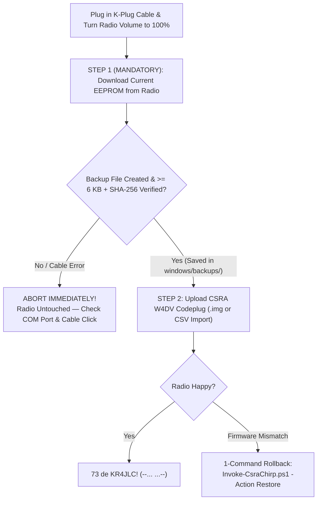

# Windows Beige-Box Field Manual: Automated & Manual CHIRP Programming (`2600 Hz` // `--... ...--`)

```text
 ._________________________________________________________________________.
 |  ____ ____ ____    _      ____  _   _ ____  _____    _    _  __         |
 | / ___/ ___|  _ \  / \    |  _ \| | | |  _ \| ____|  / \  | |/ /         |
 || |   \___ \ |_) |/ _ \   | |_) | |_| | |_) |  _|   / _ \ | ' /   [2600] |
 || |___ ___) |  _ < ___ \  |  __/|  _  |  _ <| |___ / ___ \| . \   [ Hz ] |
 | \____|____/|_| \_\_/ \_\ |_|   |_| |_|_| \_\_____/_/   \_\_|\_\  [WIN ] |
 |-------------------------------------------------------------------------|
 |  * WINDOWS FIELD MANUAL // THE KNIGHTS WHO SAY "73" (--... ...--)       |
 |  * CW: -.-. --.-  -.. .  -.- .-. ....- .--- .-.. -.-.  -...-  -.-       |
 |  * SACRED OATH: "THOU SHALT ALWAYS BACK UP BEFORE UPLOADING!"           |
 |  * Official CHIRP Wiki: https://chirpmyradio.com/projects/chirp/wiki/Home|
 `-------------------------------------------------------------------------'
```

Welcome, fellow traveler of the Central Savannah River Area (CSRA) airwaves! Whether you are a newly licensed Technician preparing for your first **Augusta Amateur Radio Club (`W4DV`)** net or a seasoned packet phreak who remembers whistling **2600 Hz** into a payphone, this guide walks you through **two rock-solid ways** to program your **Baofeng UV-5R** (and **BTECH DMR-6X2 PRO**) on **Windows 10 & Windows 11**:

1. **The Automated PowerShell Way ([`Invoke-CsraChirp.ps1`](file:///home/d4rksp2rk/Desktop/jarvis/csra-ham-dmr-automation/windows/Invoke-CsraChirp.ps1) & [`Run-CsraChirp.bat`](file:///home/d4rksp2rk/Desktop/jarvis/csra-ham-dmr-automation/windows/Run-CsraChirp.bat)):** Auto-detects your USB programming cable, **automatically downloads and SHA-256 verifies a full backup of your radio first**, and flashes the CSRA repeater catalog.
2. **The Manual CHIRP GUI Fallback Way (`chirpw.exe`):** Step-by-step instructions grounded in the official **[CHIRP Wiki (`chirpmyradio.com`)](https://chirpmyradio.com/projects/chirp/wiki/Home)** so that if a script, cable driver, or firmware mismatch ever throws a Monty Python *"flesh wound"*, you can still program your radio safely by hand in under 3 minutes.

---

## `0x00` // The Sacred Commandment of Antioch: ALWAYS Back Up First!

> [!CAUTION]
> **From *The Book of Armaments*, Chapter 2, Verse 73:**
> *"First shalt thou download the existing image from thy radio. Then shalt thou save that `.img` file into [`windows/backups/`](file:///home/d4rksp2rk/Desktop/jarvis/csra-ham-dmr-automation/windows/backups/). Never shalt thou upload a foreign `.img` file before securing thy radio's original calibration and firmware parameters—for to do so is to invite the Black Beast of Bricked EEPROM!"*

### Why Is Backing Up Before Programming So Critical?
Inside a **Baofeng UV-5R**, the 6,645-byte CHIRP `.img` file contains more than just your 128 memory channels—it also holds **factory RF squelch tables, VHF/UHF power calibration bytes, and firmware version strings** (such as `HN5RV011`, `BFB297`, or `N5R-20`).
* **In our Automated Script ([`Invoke-CsraChirp.ps1`](file:///home/d4rksp2rk/Desktop/jarvis/csra-ham-dmr-automation/windows/Invoke-CsraChirp.ps1)):** Whenever you run `-Action Flash` or `-Action All`, the script **refuses to upload anything** until it has first executed `--download-mmap` from your radio into [`windows/backups/baofeng_uv-5r_pre_flash_<TIMESTAMP>.img`](file:///home/d4rksp2rk/Desktop/jarvis/csra-ham-dmr-automation/windows/backups/), verified the file is non-empty, and written a `.manifest.json` containing its **SHA-256 cryptographic digest**. If the backup step fails for any reason, **the script aborts immediately** so your radio is never touched.
* **In the Manual CHIRP GUI:** You must **always** click **`Radio -> Download from radio`** first, save that tab as your backup `.img`, and then import our [`CSRA_W4DV_UV5R_CHIRP.csv`](file:///home/d4rksp2rk/Desktop/jarvis/csra-ham-dmr-automation/data/generated/chirp/CSRA_W4DV_UV5R_CHIRP.csv) into *your own radio's downloaded tab*.



---

## `0x01` // Prerequisites & Physical Hardware Prep (Don't Skip This!)

Before running either the automated script or manual CHIRP, check these 4 physical rules from the **[Official CHIRP Wiki](https://chirpmyradio.com/projects/chirp/wiki/Home)**:

1. **Install CHIRP-next for Windows:**
   * Download and install the latest **CHIRP-next Windows Installer** from **[https://chirpmyradio.com/projects/chirp/wiki/Download](https://chirpmyradio.com/projects/chirp/wiki/Download)**.
   * It installs both the graphical app (`chirpw.exe`) and the command-line tool (`chirpc.exe`) into `C:\Program Files (x86)\CHIRP\` (or `C:\Program Files\CHIRP\`).
2. **Plug the Cable in ALL the Way (The Famous "Baofeng Click"):**
   * The 2-pin Kenwood (K1) connector on the side of the Baofeng UV-5R is notorious for stopping `1 mm` short because of the rubber dust cover. **Push firmly until you feel a hard second click**—nearly 80% of `"Radio did not respond"` errors are caused by a plug that is only 95% seated!
3. **Turn the Radio Volume Knob to 100% (Maximum):**
   * The UV-5R's serial RX/TX lines share the speaker/mic jacks. Turn the volume knob all the way up (`100%`), and tune the radio to an unused simplex frequency (e.g., `146.500 MHz`) so incoming repeater chatter doesn't interrupt the serial data stream!
4. **Verify Your USB Cable Driver in Windows Device Manager:**
   * Press **`Win + X`** and select **Device Manager**, then expand **Ports (COM & LPT)**.
   * Plug in your USB programming cable (without the radio attached yet) and look for **`COM3`**, **`COM4`**, **`COM5`**, etc.

> [!WARNING]
> **The Infamous Counterfeit Prolific PL2303 Cable Issue (Yellow Triangle / Error Code 10):**
> * **FTDI (`VID_0403&PID_6001`)** and **WCH CH340 (`VID_1A86&PID_7523`)** cables work seamlessly on Windows 10/11.
> * Cheap **Prolific PL2303** clone cables often show a yellow exclamation mark in Device Manager (`This device cannot start (Code 10)` or `PL2303HXA PHASED OUT SINCE 2012`) because Windows Update installs a newer driver that blocks clone chips.
> * **The Fix:** Either use a genuine **FTDI / WCH CH340** cable ( like the BTECH PC03 FTDI cable), or follow the [CHIRP Wiki Cable Guide](https://chirpmyradio.com/projects/chirp/wiki/CableGuide) to roll back the Prolific driver to version `3.3.2.102` (2008).

---

## `0x02` // Method 1: Automated Windows PowerShell Suite

### Option A: Double-Click the Interactive Menu ([`Run-CsraChirp.bat`](file:///home/d4rksp2rk/Desktop/jarvis/csra-ham-dmr-automation/windows/Run-CsraChirp.bat))
For the easiest experience, simply double-click **[`windows\Run-CsraChirp.bat`](file:///home/d4rksp2rk/Desktop/jarvis/csra-ham-dmr-automation/windows/Run-CsraChirp.bat)**. It automatically bypasses PowerShell's default `ExecutionPolicy` for that window and presents an interactive 90s BBS menu:
* **`[1]` Detect Radio USB/COM Ports & CHIRP Installation**
* **`[2]` Backup Radio EEPROM Only** *(Saves timestamped `.img` + SHA-256 manifest in `windows\backups\`)*
* **`[3]` SAFE FLASH: Mandatory Pre-Flash Backup + Upload CSRA W4DV Codeplug**
* **`[4]` ROLLBACK: Restore Latest Pre-Flash Backup Image to Radio**
* **`[5]` Launch CHIRP GUI (`chirpw.exe`) with CSRA CSV & Latest Backup Pre-Loaded**
* **`[6]` Sync Latest W4DV / ICS-217 / TGIF Data & Rebuild Codeplugs**

### Option B: Run [`Invoke-CsraChirp.ps1`](file:///home/d4rksp2rk/Desktop/jarvis/csra-ham-dmr-automation/windows/Invoke-CsraChirp.ps1) Directly in PowerShell
Open **PowerShell** in the `windows\` folder:

```powershell
# Allow running local scripts in this PowerShell session
Set-ExecutionPolicy -Scope Process -ExecutionPolicy Bypass

# 1. Scan Windows Device Manager for your cable's COM port & verify CHIRP install
.\Invoke-CsraChirp.ps1 -Action Detect

# 2. Take a standalone verified backup of your radio's current memory
.\Invoke-CsraChirp.ps1 -Action Backup -ComPort COM4 -RadioModel Baofeng_UV-5R

# 3. SAFE FLASH (Automatically downloads & SHA-256 verifies a backup FIRST, then flashes!)
.\Invoke-CsraChirp.ps1 -Action Flash -ComPort COM4 -RadioModel Baofeng_UV-5R

# 4. Need to undo or go back to how your radio was before? 1-command Rollback!
.\Invoke-CsraChirp.ps1 -Action Restore -ComPort COM4

# 5. Encode/Decode ITU Morse Code (--... ...--) right from PowerShell!
.\Invoke-CsraChirp.ps1 -Action Morse -Message "CQ CQ DE KR4JLC 73"
.\Invoke-CsraChirp.ps1 -Action Morse -DecodeMorse -Message "-.-. --.- / -.. . / -.- .-. ....- .--- .-.. -.-. / --... ...--"
```

---

## `0x03` // Method 2: Manual CHIRP GUI Steps (When Automation Breaks Down)

If `chirpc.exe` changes flags in a future CHIRP-next build, or if your **Baofeng UV-5R** uses a different factory firmware revision than our baseline `HN5RV011` (for example `BFB297`, `N5R-20`, or a `UV-5R+` / `BF-F8HP`), **never force-upload a foreign `.img` file**. Instead, use the **CSV Import into Your Own Backup** method below—this works on **100% of CHIRP-supported radios**!

### Step 1: Launch CHIRP and Download From Your Radio FIRST (Mandatory Backup!)
1. Open **CHIRP** (`chirpw.exe`) from your Start Menu (or run `.\Invoke-CsraChirp.ps1 -Action LaunchGui`).
2. Turn on your radio, set Volume to **100%**, and plug in the USB programming cable firmly until it clicks.
3. In the top menu bar, click **`Radio` $\rightarrow$ `Download from radio`**.
4. Select:
   * **Port:** Your cable's COM port (e.g., `COM4`)
   * **Vendor:** `Baofeng`
   * **Model:** `UV-5R` (or `BF-F8HP` / `UV-82` depending on your exact radio)
5. Click **OK** and follow the on-screen prompt. You will see the red/green LED flash on your radio as CHIRP clones its memory.
6. **SAVE YOUR BACKUP IMMEDIATELY:** Before touching a single channel, click **`File` $\rightarrow$ `Save As...`** and save this unmodified image into [`windows\backups\My_Original_Radio_Backup.img`](file:///home/d4rksp2rk/Desktop/jarvis/csra-ham-dmr-automation/windows/backups/).
   * *Why?* This `.img` file contains your specific radio's factory firmware header and VHF/UHF calibration data. Keep it safe forever!

### Step 2: Import the CSRA W4DV Channels into Your Radio's Tab
1. Make sure the tab you just downloaded from your radio is still selected and active in CHIRP.
2. Click **`File` $\rightarrow$ `Import...`** in the top menu bar.
3. Browse to this repository's generated CHIRP CSV file:
   * [`data\generated\chirp\CSRA_W4DV_UV5R_CHIRP.csv`](file:///home/d4rksp2rk/Desktop/jarvis/csra-ham-dmr-automation/data/generated/chirp/CSRA_W4DV_UV5R_CHIRP.csv)
4. CHIRP will show a preview of all **86 CSRA / W4DV / Simplex / Travel / NOAA Weather channels** (complete with 7-character LCD names, CTCSS PL tones, repeater offsets, and `Duplex=off` TX locks on NOAA Weather).
5. Click **OK** to import them into your radio's memory table.
6. Save a copy of your newly populated image via **`File` $\rightarrow$ `Save As...`** (e.g., `windows\backups\My_UV5R_With_CSRA_Channels.img`).

### Step 3: Upload to Your Radio
1. With your populated radio tab active, click **`Radio` $\rightarrow$ `Upload to radio`**.
2. Confirm your **Port** (`COM4`), **Vendor** (`Baofeng`), and **Model** (`UV-5R`), and click **OK**.
3. Wait for the progress bar to reach 100% and your radio to reboot. You are now on the air with all W4DV and CSRA repeaters!

### Step 4: How to Manually Restore Your Backup If Anything Ever Goes Wrong
1. Open **CHIRP** (`chirpw.exe`).
2. Click **`File` $\rightarrow$ `Open...`** and select your saved backup file from [`windows\backups\`](file:///home/d4rksp2rk/Desktop/jarvis/csra-ham-dmr-automation/windows/backups/) (either the one created automatically by `Invoke-CsraChirp.ps1` or `My_Original_Radio_Backup.img`).
3. Click **`Radio` $\rightarrow$ `Upload to radio`** and click **OK**. Your radio is immediately restored to its exact pre-flash state!

---

## `0x04` // Manual Windows Steps for BTECH DMR-6X2 PRO (`D6X2UV2`)

While CHIRP handles analog radios like the Baofeng UV-5R, the **BTECH DMR-6X2 PRO** is a dual-band Tier-II DMR digital radio with a `1,606,528`-byte codeplug image.

* **On Linux:** Our custom-patched [`bin/dmrconfig`](file:///home/d4rksp2rk/Desktop/jarvis/csra-ham-dmr-automation/bin/dmrconfig) (`1.1.259-pro`) flashes [`data/generated/dmrconfig/CSRA_W4DV_DMR6X2PRO.img`](file:///home/d4rksp2rk/Desktop/jarvis/csra-ham-dmr-automation/data/generated/dmrconfig/CSRA_W4DV_DMR6X2PRO.img) directly over USB (`28e9:018a`).
* **On Windows (Using Official BTECH DMR-6X2 PRO CPS):**
  1. Connect your BTECH DMR-6X2 PRO to your PC using the direct USB-C / Micro-USB programming cable (the radio enumerates as a GD32 Virtual COM port `VID_28E9&PID_018A`—no FTDI/CH340 chip is inside the BTECH cable).
  2. Open the official **BTECH DMR-6X2 PRO CPS** on Windows and select **`Set` $\rightarrow$ `Set COM`** to pick the radio's COM port.
  3. **MANDATORY BACKUP FIRST:** Click **`Program` $\rightarrow$ `Read From Radio`** and save your original `.rdt` codeplug backup into [`windows\backups\BTECH_DMR6X2PRO_Original_Backup.rdt`](file:///home/d4rksp2rk/Desktop/jarvis/csra-ham-dmr-automation/windows/backups/).
  4. Review the human-readable tables in [`data/generated/dmrconfig/CSRA_W4DV_DMR6X2PRO.conf`](file:///home/d4rksp2rk/Desktop/jarvis/csra-ham-dmr-automation/data/generated/dmrconfig/CSRA_W4DV_DMR6X2PRO.conf) (41 Digital DMR channels, 86 Analog channels, 9 Zones, 4 Group Lists, and 1,021 Contacts) or use WSL2 usbipd-win (`usbipd attach --wsl --busid <BUSID>`) to run `./bin/csra-radio flash --radio btech` directly from Windows!

---

## `0x05` // Quick Troubleshooting Cheat Sheet (From the CHIRP Wiki)

| Symptom / Error Message | Root Cause | Fix |
| :--- | :--- | :--- |
| **`Radio did not respond` / `No response from radio`** | 2-pin K1 plug is 1 mm away from seating, or volume is too low | Push the 2-pin plug into the side of the UV-5R **hard until it clicks**; set Volume knob to **100%**; tune to an empty simplex frequency. |
| **COM Port has Yellow Triangle in Device Manager (`Code 10`)** | Counterfeit Prolific PL2303 chip blocked by Windows 10/11 driver | Switch to a genuine **FTDI / WCH CH340** cable, or install the legacy Prolific `v3.3.2.102` driver per the [CHIRP Wiki Cable Guide](https://chirpmyradio.com/projects/chirp/wiki/CableGuide). |
| **`Error: Firmware version not supported` / `Image not compatible`** | Your UV-5R has a newer/older firmware string than `HN5RV011` | Do **not** upload a pre-compiled `.img`. Follow **Method 2 (`0x03`)**: `Radio -> Download from radio`, save backup, then `File -> Import` [`CSRA_W4DV_UV5R_CHIRP.csv`](file:///home/d4rksp2rk/Desktop/jarvis/csra-ham-dmr-automation/data/generated/chirp/CSRA_W4DV_UV5R_CHIRP.csv)! |
| **Radio transmits continuously when cable is plugged in** | Cable was plugged in while the radio was already powered on | Turn the radio **OFF**, plug the 2-pin cable in firmly until it clicks, and **then** turn the radio **ON** at 100% volume. |

```text
-.-. --.-  -.. .  -.- .-. ....- .--- .-.. -.-.  //  ALWAYS BACK UP FIRST  //  73 (--... ...--)
```
